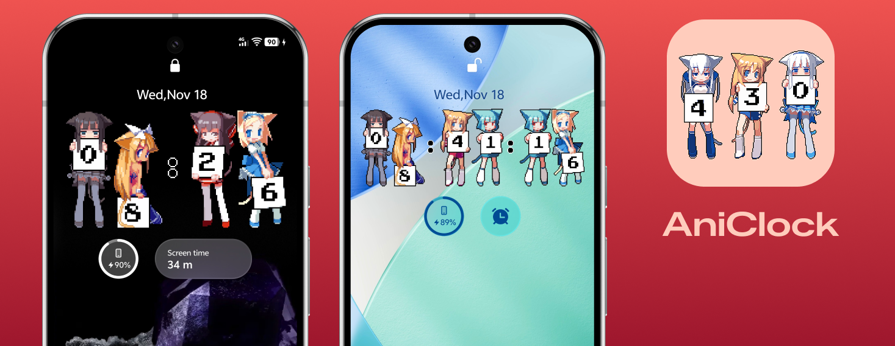

# AniClock

An LSPosed module for OriginOS that replaces the lock screen clock with an animated character clock widget.

## Build

Requires **JDK 17** and **Android SDK 35** (`ANDROID_HOME` set or `sdk.dir=...` in `local.properties`).

```bash
# Using Make (creates dist/*.apk)
make

# Or using Gradle directly
./gradlew :app:assembleDebug
```

The built APK is located at `dist/*.apk`.

## Credits

All credits belong to the original artist **日下こかげ (Kusaka Kokage)** (`@K_KOKAGE` on Twitter/X) and to the original creator of the AniTime widget for macOS, **Charlie Chiang**.